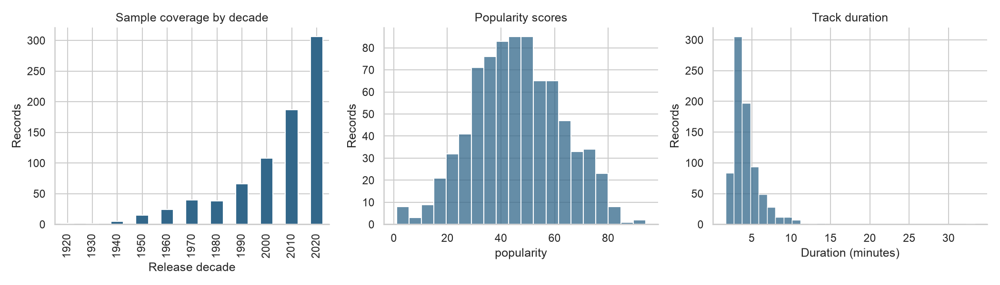
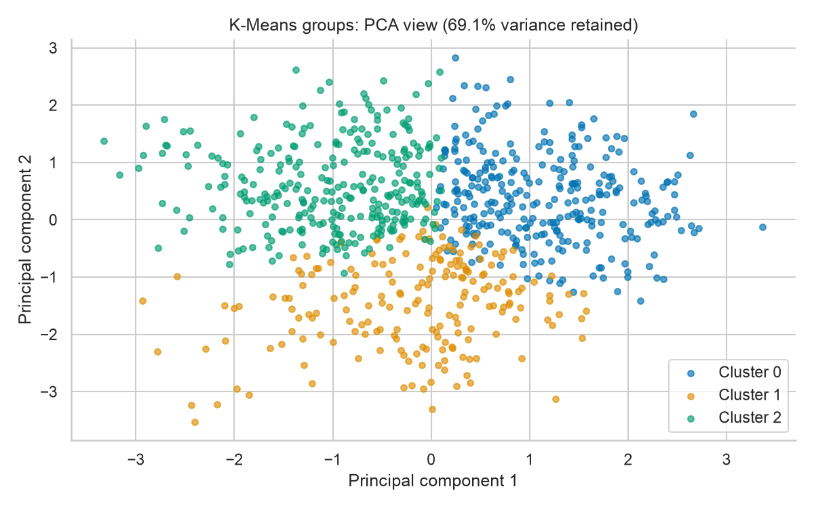

# Music Data Analysis

Exploring song profiles and the limits of popularity classification with Python.

Can audio features form interpretable groups of songs, and do they help classify popularity
for artists absent from the training data? This project investigates those questions through
data validation, visual exploration, clustering and a comparison of three classifiers.

**[Read the executed notebook](music_analysis.ipynb)** for the complete analysis and its outputs.



## Data and scope

The included CSV contains **795 records and 16 columns**, with release years from
1927 to 2023. It includes artist and track names, a popularity score and
audio descriptors such as danceability, energy, loudness, acousticness, valence and tempo.

The notebook removes 3 exact duplicate rows from its working copy,
leaving **792 records**. The original CSV is unchanged. One repeated
artist/title pair has conflicting release years and remains flagged rather than arbitrarily
corrected. Some titles also have apparent encoding damage.

About 76% of the analysed records date from 2000 onwards; the 1930s have
just one record. The analysis describes this sample rather than the history of music.

The project author identifies [Music Genre Classification on Kaggle](https://www.kaggle.com/datasets/purumalgi/music-genre-classification)
as the source. The uploader, Purushottam Malgi, credits a MachineHack hackathon.
This CSV is an adapted extract: it omits the documented `instrumentalness` and genre `Class`
columns and includes `release_year`, absent from the source card's schema. The selection and
transformation steps, including the origin of the years, have not been preserved. Decade plots
therefore describe provisional local metadata. Kaggle labels the licence **Other (specified
in description)**; this repository does not assume a standard open-data licence for the CSV.

## Approach

- Validate the schema, missing values, finite numbers and expected numeric ranges.
- Inspect distributions, correlations and decade coverage; retain IQR outliers for inspection.
- Standardise four audio features and compare K-Means with k=2 through k=10 using silhouette
  scores. Visualise the selected groups with PCA and compare with Ward clustering on a fixed
  100-record sample using Adjusted Rand Index.
- Compare Decision Tree, Random Forest and Gaussian Naive Bayes against a majority-class
  baseline, using five-fold cross-validation that keeps artist groups separate.
- Select the trained model using training CV only, then evaluate it and the baseline on a
  separate artist-group test partition. Assertions check group separation and metric ranges.

## Findings

### Song clusters

The highest silhouette score among the tested values selects **k=3**, with a score
of **0.249**. The two PCA components retain **69.1%** of the
variance. These groups describe audio profiles; they are not verified musical genres.



### Popularity classification

Class 1 means a recorded popularity score **strictly above 50**. This is a
fixed illustrative threshold, not a forecast of future hits. It replaces the original
sample-median target, so the previous notebook's scores are not directly comparable.

The split contains **641 training records from 588 artist
groups** and **151 test records from 147 other artist groups**.
Grouping uses normalised credited-name strings; aliases and collaborations may still overlap.

Training-only cross-validation results:

| Model | Mean balanced accuracy | Fold standard deviation |
| --- | --- | --- |
| Gaussian Naive Bayes | 58.27% | 2.69% |
| Random Forest | 53.73% | 3.98% |
| Decision Tree | 52.73% | 5.39% |
| Majority baseline | 50.00% | 0.00% |

The highest mean balanced accuracy selects **Gaussian Naive Bayes**. The standard deviation describes
fold variation, not a confidence interval. Only the selected trained model and baseline are
then evaluated on the test partition:

| Model | Accuracy | Balanced accuracy | F1, class 1 | ROC AUC |
| --- | --- | --- | --- | --- |
| Majority baseline | 68.21% | 50.00% | 0.000 | 0.500 |
| Gaussian Naive Bayes | 60.26% | 55.30% | 0.400 | 0.631 |

The selected model improves balanced accuracy over the baseline but has lower overall
accuracy. The baseline predicts the more frequent class every time. Balanced accuracy
averages recall across both classes, making this trade-off visible. The results suggest
limited discrimination in this experiment and do not establish a reliable advantage on
other catalogues.

## Reproduce the analysis

Tested with **Python 3.12.14** and the pinned dependencies in
[`requirements.txt`](requirements.txt). No API keys or external data downloads are required
after obtaining the repository and installing the dependencies.

```bash
git clone https://github.com/nachopalomares/DataMining.git
cd DataMining
python3.12 -m venv .venv
source .venv/bin/activate
python -m pip install -r requirements.txt
python -m jupyter lab music_analysis.ipynb
```

On Windows, activate the environment with `.venv\Scripts\activate`. Keep the working
directory at the repository root and run all cells from a fresh kernel. To execute without
the Jupyter interface:

```bash
python -m nbconvert --to notebook --execute --inplace music_analysis.ipynb
```

The notebook regenerates the charts in [`assets/`](assets/) and the numerical tables in
[`results/`](results/), including [`summary.json`](results/summary.json). The committed
notebook has been executed from a fresh kernel; all 13 code cells and the embedded checks passed.

## Limitations and next step

The sample is small and uneven, its transformations are undocumented, and one release-year
conflict remains unresolved. The dataset has already been explored, so the test evaluation is not an
external or prospective validation. Cluster stability, other catalogues, future periods and
threshold sensitivity have not been tested.

The next useful step is to document the extract's preparation and evaluate on a larger sample
before adding model complexity.
